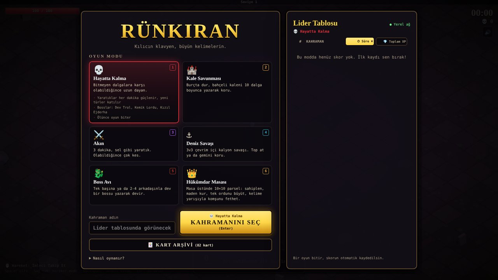
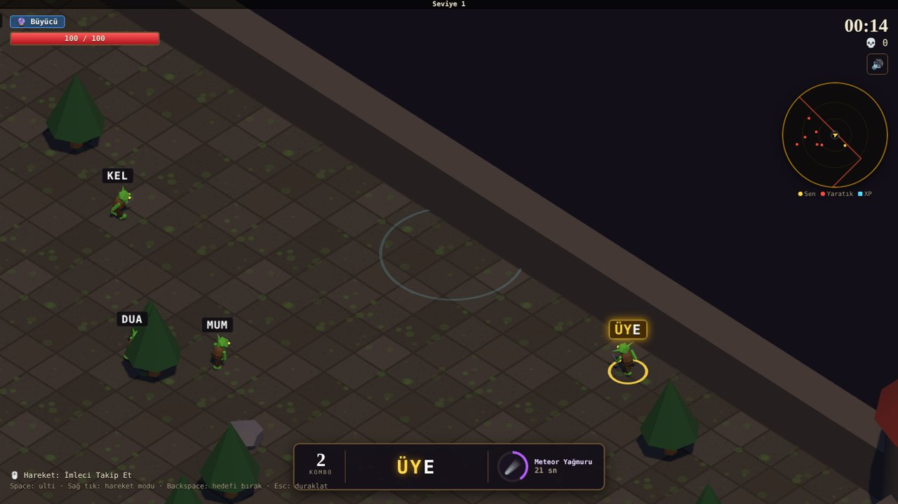
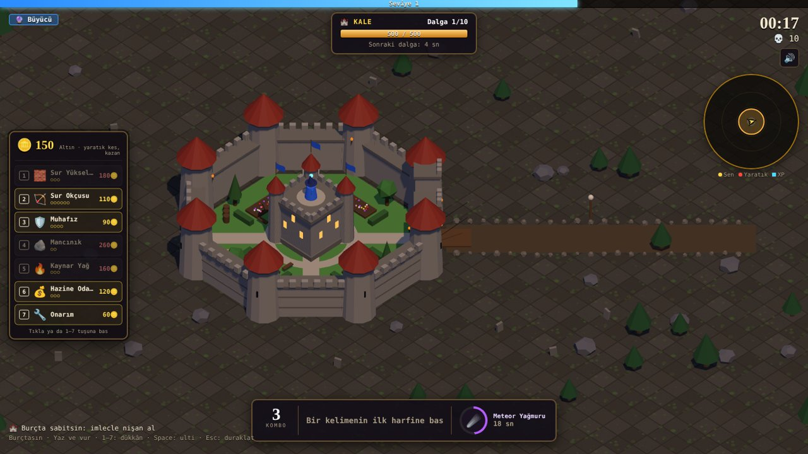
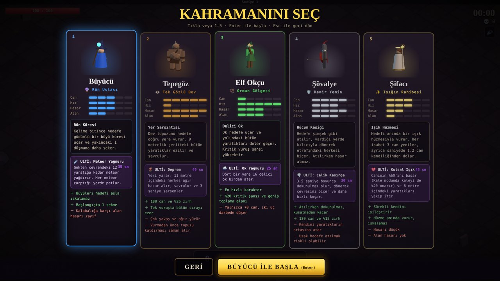

# RÜNKIRAN — 3D Yazma Roguelike Prototipi

Vampire Survivors × Typing of the Dead. Three.js (r160) ile, derleme adımı olmadan tarayıcıda çalışır.

Düşmanların üzerindeki **Türkçe kelimeleri yazarak** savaştığın, izometrik 3D bir hayatta kalma oyunu.
6 oyun modu, 5 kahraman, 82 yetenek kartı ve yerel ağda arkadaşlarla çevrim içi oynama desteği var.
Eğlenceli bir şekilde **Türkçe klavyede hızlı ve hatasız yazmayı** geliştirmek isteyenler için.



| Hayatta Kalma | Kale Savunması |
|---|---|
|  |  |



> *A 3D typing roguelike in Turkish: defeat monsters by typing the words above them. Six game modes, five heroes,
> 82 upgrade cards and LAN multiplayer. Runs in the browser with Three.js, no build step. Start with `node server/server.js`
> and open `http://localhost:8000`.*

## ⚡ Hızlı Başlangıç

```bash
git clone https://github.com/Mehmetsndl/runkiran.git
cd runkiran
node server/server.js        # Windows: baslat.bat · Mac/Linux: ./baslat.sh
# Tarayıcıda: http://localhost:8000
```

## Çalıştırma

ES modülleri kullandığı için dosyayı çift tıklayarak değil, yerel bir sunucuyla açın:

```bash
cd runkiran
python -m http.server 8000      # veya: npx serve .
# Tarayıcıda: http://localhost:8000
```

## 🖧 Arkadaşlarla Yerel Ağda Oynamak (Radmin VPN / Hamachi / aynı Wi-Fi)

Deniz Savaşı eşleştirmesi ve ortak lider tablosu, oyunu birlikte gelen küçük sunucuyla açınca
claude.ai'a gerek kalmadan çalışır. Sunucu ek paket istemez, yalnızca **Node.js** gerekir.

**Sunucuyu açan kişi (1 kişi yeterli):**
1. https://nodejs.org adresinden Node.js **LTS** sürümünü kur.
2. Radmin VPN'de bir ağ oluştur (Ağ → Yeni ağ oluştur), ağ adını ve şifresini arkadaşlarına ver.
3. Proje klasöründeki **`baslat.bat`** dosyasına çift tıkla (Mac/Linux: `./baslat.sh`).
4. Açılan pencerede şöyle bir satır görürsün:
   `Arkadaşların için: http://26.x.x.x:8000  ← Radmin VPN`
5. Windows güvenlik duvarı sorarsa **"Özel ağlar"** için izin ver.
6. Sen de oyunu tarayıcıda `http://localhost:8000` adresinden aç.

**Arkadaşlar:**
1. Radmin VPN'i kurup aynı ağa katıl.
2. Tarayıcıda sunucuyu açanın verdiği adresi aç: `http://26.x.x.x:8000`
3. **Deniz Savaşı** → lobide **Kaptan adını** yaz → aynı kuyruğa gir. (Ad yazmadan kuyruğa girilemez; yapay zekâ oyuncular "Yapay Zekâ 1, 2..." diye görünür.)

Menüdeki lider tablosunda **"● Yerel ağ"** yazıyorsa bağlantı tamamdır. Skorlar sunucuyu açanın
bilgisayarında, oyun klasörünün **dışında** kalıcı olarak saklanır:
`C:\Users\<ad>\RunkiranVerileri\skorlar.json` (Mac/Linux: `~/RunkiranVerileri/skorlar.json`).
Dosya sunucu ilk açıldığında kendiliğinden oluşur. Oyunun yeni sürümünü başka bir klasöre açsan da
tablo silinmez, eski `server/veriler.json` varsa ilk açılışta otomatik taşınır. Her kayıtta bir yedek
(`skorlar.json.yedek`) tutulur ve pencere kapatılırken bekleyen kayıt diske yazılır. Başka bir konum
istersen: `RUNKIRAN_DATA=D:\Skorlar` ortam değişkeni. Aynı Wi-Fi'deyseniz VPN'e gerek yok;
pencerede yazan `192.168.x.x` adresini kullanın. Three.js projeyle birlikte geldiği (`vendor/`)
için internet bağlantısı olmadan da oynanır.

**Sorun çıkarsa:** Bağlanılamıyorsa güvenlik duvarında Node.js'e izin verildiğini, adresin sonunda
`:8000` olduğunu ve herkesin Radmin VPN'de aynı ağda "yeşil" göründüğünü kontrol et. Port doluysa
`node server/server.js 9000` ile başka port kullan.

## Oyun Modları

| Mod | Amaç | Lider tablosu sütunları |
|---|---|---|
| 🐉 Boss Avı | Tek başına ya da 2-4 kişi aynı bossa karşı, ortak can çubuğu | Devrilen boss (toplam), En çok hasar |
| 💀 Hayatta Kalma | Bitmeyen dalgalar: her birkaç dakikada yeni yaratık, sürüler ve bosslar | Süre, Toplam XP |
| 🏰 Kale Savunması | Burçta sabit durarak 10 dalga boyunca bahçeli kaleyi koru | Dalga, Toplam XP |
| ⚔️ Akın | 3 dakikada olabildiğince çok yaratık kes | Öldürme, Toplam XP |
| ⚓ Deniz Savaşı | 3v3 çevrim içi kalyon savaşı (6 kişi, 3 kişi + 3 AI ya da antrenman) | Galibiyet (toplam), Katkı |
| 👑 Hükümdar Masası | Masadaki 10×10 parsel haritasında fetih: tek ordu, saldırılar iki taraflı kelime yarışı (4 kişi çevrim içi, boş koltuğa YZ) | Galibiyet (toplam), Öldürülen birlik |

Lider tablosu her mod için **tek tablodur**: iki bilgi yan yana görünür (ör. Süre ve Toplam XP).
Sütun başlığına tıklayınca tablo o sütuna göre sıralanır.

## 🐉 Boss Avı

Tek başına ya da 2-4 arkadaşınla aynı bossa karşı: **Dev Trol** (★), **Kemik Lordu** (★★), **Kızıl Ejderha** (★★★);
zorluk Kolay / Normal / Zor. Kahramanını seç → av lobisinde adını yaz, bossu ve zorluğu seç → **Hemen Başla** ya da
2/3/4 kişilik kuyruğa gir (boss'u kuyruğun başındaki oyuncu seçer).

- Herkesin yazdığı kelime **ortak can çubuğundan** düşer; boss canı her ek oyuncuda +%70.
- Boss %66 ve %33 canda yeni faza geçer: yetenekleri hızlanır, herkes bir kart seçer ve %25 can kazanır.
- Kart seçimi: tek başına normal kart ekranı açılır (oyun durur). Arkadaşlarla oynarken oyun durmaz; kartlar ekranın altında
  küçük çıkar, 1/2/3 ya da tıklayarak seçersin, bu sırada yazmaya devam edebilirsin.
- 5:30'da öfkelenir (hasar ×1.6). 7 dakikada yenilmezse av başarısız.
- Çevrim içinde düşen oyuncu 8 sn sonra %50 canla kalkar; herkes aynı anda düşerse av biter. Tek başına ölürsen biter.
- Ekip arkadaşların sahnede adlarıyla ve can çubuklarıyla görünür; üstteki panelde herkesin verdiği hasar yazar.
- Kod: `js/boss/` (lobi + ağ), `js/systems/modes/BossRaidMode.js`, ayarlar `js/data/bossRaid.js`.

## 🗺️ Mini harita

Sağ üstte kahramanı merkeze alan mini harita: sarı ok sensin (baktığın yön), kırmızı noktalar yaratıklar, mor elitler,
turuncu nabız atan nokta boss (uzaktaysa kenarda ok), mavi kareler yerdeki XP kristalleri, yeşil noktalar Boss Avı'ndaki
ekip arkadaşların. Harita ekranla aynı yöne bakar. Tıklayınca büyür / küçülür. Kod: `js/ui/MiniMap.js`.

## 🔤 Kelimeler

Yalnızca gerçek Türkçe kelimeler (`js/data/words.js`, ~800 kelime). Harf sayısına göre kendiliğinden ayrılır
(3 / 4 / 5 / 6-7 harf). Kelimeler torbadan çekilir: torba bitene kadar aynı kelime tekrar gelmez.

## 💀 Hayatta Kalma: yaratıklar ve bosslar

Her dakika canlar %26 artar, 8. dakikadan sonra yaratıklar dakikada %3 hızlanır (en çok %45).

| Dakika | Gelenler |
|---|---|
| 0:30 | 😈 **Cin**: minik, çok hızlı, 3 harfli; 5'li sürüler halinde koşar |
| 1:10 – 2:00 | İskeletler, orklar, Ork Şefi |
| 2:55 | 👑 **BOSS · Dev Trol**: sopasını kaldırınca hamle yapar, yere vurup şok dalgası çıkarır |
| 4:00 | 🐺 **Kurt** sürüleri |
| 5:10 | 🐲 **Yavru Ejderha**: uçar, uzaktan ateş topu tükürür |
| 6:40 | 👑 **BOSS · Kemik Lordu**: iskelet diriltir, yeşil ruh dalgası patlatır |
| 7:50 | Cin Fırtınası (9'lu sürüler) |
| 11:00 | 👑 **BOSS · Kızıl Ejderha**: ateş nefesi, ateş topu yağmuru, yavru çağırma |
| 14:30 | 👑 Çifte boss: Trol + Kemik Lordu |
| 16:30+ | Sonsuz Gece: 2,5 dakikada bir boss döner, sürüler büyür |

Bossların ekranın altında büyük can çubuğu var; boss düşünce canın %30 dolar. Yetenekler `js/systems/BossSystem.js`,
dalgalar `js/data/waves.js`, yaratıklar `js/data/enemies.js` ve modelleri `js/entities/EnemyModels.js`.

## 👑 Hükümdar Masası (Parsel Fethi)

Kare savaş masasının üstü **10×10 parsellik** bir harita: 🌱 çayır, 🌲 orman, 💎 cevher, 🏚️ harabe (haydutlar + ganimet),
⛰️ dağ ve 🌊 göl (geçilmez), dört köşede hükümdarların 🏰 kaleleri, ortada 👑 hazine (güçlü haydutlar, büyük ganimet).

**Tur:** gelir gelir → parsele tıkla → **Enter** (sahiplen / saldır) → turu bitir (Space). Ekranın solunda kısa bir "Nasıl oynanır" rehberi var.

| Eylem | Nasıl | Bedel |
|---|---|---|
| 🚩 Sahiplen | Kendi parseline komşu boş (mavi parlayan) parsele tıkla, Enter | 3🪙 (orman/cevher 4) |
| ⛏️ Maden | Cevherli parselde, 3 seviye | 6 / 9 / 14🪙 → her tur +3 / +6 / +10🪙 |
| ⛺ Kamp | Seviyesi yeni birlikleri açar (en yüksek kampın geçerli) | 8 / 12 / 18🪙 |
| 🧱 Sur | Parselin surunu yükseltir | 5 / 9 / 14🪙 |
| 🗡️ Birlik al | Alttaki **ORDUN** çubuğundan, her an | birliğe göre |
| ⚔️ Saldır | Komşu düşman / haydut parseline (kırmızı parlayan) tıkla, Enter (tur başına 2) | — |

**Tek ordu:** her hükümdarın tek bir ordusu vardır; parsellere dağılmaz, taşınmaz. Saldırırken de savunurken de
**bütün ordu** savaşır. Ordu masada başkentinin üstünde durur.

**Kelime yarışı (savaş):** iki taraf aynı kelimeyi görür. **Önce ve hatasız** bitiren kelimeyi kazanır ve rakip
ordudan birlik öldürür (kelime başına 1 + ordu seviyesi / 10, her 2 büyücü +1). Yanlış harf yazan o kelimeyi baştan
yazmak zorunda kalır. 7 kelimelik yarışta saldıran savunandan **daha çok** kelime kazanırsa parseli alır; eşitlik ya da
savunanın üstünlüğünde parsel savunanda kalır. Sana saldırıldığında sıra sende olmasa bile yazarsın: hızlı ve hatasızsan
parselin elinde kalır. Rakibinin ilerlemesi çubuk olarak görünür. Haydutlar yavaş yazar, yapay zekâ ara sıra hata yapar.

**Sur:** sur seviyesi × 3 ordu seviyesi olmadan o parsele saldırılamaz (sur 3 → en az 9). Ayrıca savunan, sur seviyesi
kadar kelime **önde** başlar (her mancınık bu avantajı 1 azaltır). Fethedilen parselin suru ve madeni bir seviye düşer.

| Birlik | Seviye | Bedel | Özellik | Kamp |
|---|---|---|---|---|
| 🗡️ Piyade | 1 | 2🪙 | Ucuz kalabalık | 1 |
| 🏹 Okçu | 2 | 4🪙 | Savaş başında her 2 okçu 1 düşman öldürür | 1 |
| 🐎 Atlı | 3 | 6🪙 | Surları aşmak için sağlam seviye | 2 |
| 🔮 Büyücü | 3 | 8🪙 | Her 2 büyücü kazanılan kelimede +1 öldürür | 2 |
| 🪨 Mancınık | 4 | 10🪙 | Savunanın sur avantajını 1 kelime azaltır | 3 |
| 🗿 Dev | 5 | 13🪙 | En yüksek seviye | 3 |

Savunan haydut kalmazsa ya da yarış kazanılırsa parsel ve ganimeti (harabe hazinesi + maden/kamp/sur yağması) senin olur.
Kalesi düşen elenir, altınının yarısı fatihe kalır. 18 tur dolarsa en çok parseli olan kazanır.
Kahramanların masada kendi güçleri var (ucuz birlik, güçlü sur, şifacının birlik kurtarması vb.).

Çevrim içi: 4 kişilik ya da 2 kişilik (+2 YZ) kuyruk; Tek Başına ile 3 yapay zekâya karşı. Kurallar `js/fetih/FetihSim.js`,
ayarlar ve birlikler `js/data/fetih.js`, sahne `js/fetih/FetihScene.js`, arayüz `js/fetih/FetihGame.js`.

## Karakterler

| Karakter | Saldırı | Özellik | Ulti (Space) |
|---|---|---|---|
| 🔮 Büyücü | Güdümlü büyü küresi, 1 sekme | Dengeli | ☄️ Meteor Yağmuru (35 sn) |
| 👁️ Tepegöz | Yere vurur, önündeki şeridi ezer | 180 can, %25 zırh, çok yavaş | 🌋 Deprem (40 sn) |
| 🏹 Elf Okçu | Yolundaki her şeyi delen ok | En hızlı, %20 kritik, 70 can | 🌧️ Ok Yağmuru (25 sn) |
| 🛡️ Şövalye | Hedefe atılır, etrafını biçer | Atılırken dokunulmaz, 130 can | 🌪️ Çelik Kasırga (30 sn) |
| ✨ Şifacı | Anında vuran ışık hüzmesi, isabette can | Sürekli can yeniler | 💖 Kutsal Işık: %60 can (45 sn) |

### 🏰 Kale Savunması Ayrıntıları

- Kahraman kalenin ortasındaki **burcun tepesinde sabit** durur, imleçle nişan alır ve yazarak savunur.
- Yaratıklar her zaman **sağdaki tek yoldan** gelip kapıya yürür. Kamera geniş açıdan bakar, üstteki arayüz yolu kapatmaz.
- **Altın 🪙:** Her öldürme altın verir (goblin 3, iskelet 5, ork 10, şef 40). Dalga bitince de bonus gelir.
- **Kale Dükkânı (sol panel, tıkla ya da 1–7):**

| Tuş | Yükseltme | Etki | Görünüm |
|---|---|---|---|
| 1 | 🧱 Sur Yükseltmesi (3 sv.) | Surlar +250/+300/+400 can | Sağlam Sur (payandalar) → Demir Sur (kazıklar, sancaklar, koyu çatılar) → Altın Kale (mermer duvar, altın kenarlar, mavi çatılar) |
| 2 | 🏹 Sur Okçusu (6) | Kulelerden ok yağdırır | Kule tepelerinde okçular |
| 3 | 🛡️ Muhafız (4) | Kapı önünde yaratıkları durdurur, mızrakla deşer. Düşerse 14 sn sonra geri gelir | Kapı önünde mızraklı askerler |
| 4 | 🪨 Mancınık (2) | En kalabalık gruba dev taş fırlatır | Avluda ahşap mancınık |
| 5 | 🔥 Kaynar Yağ (3) | Sura dayananları haşlar | Surlarda ateşli kazanlar |
| 6 | 💰 Hazine Odası (3) | Altın kazancı +%25 | Avluda altın sandıkları |
| 7 | 🔧 Onarım | Surları %30 onarır | — |

- Okçu alınan kulenin çatısı kalkar, mazgallı açık bir okçu platformuna dönüşür.
- Yardımcılar senin yazmaya başladığın ya da büyünün yolda olduğu yaratığa **dokunmaz**. Hedefin yine de başka bir şeyle (patlama, yanma, mancınık) ölürse kelimenin kalanını cezasız yazarsın, kombo bozulmaz.
- Kale kartları (Dikenli Surlar, Duvarcı Loncası, Kutsal Taş, Usta Askerler, Savaş Davulu, Hazine Avcısı...) dükkânla birlikte çalışır.
- Bu modda kartlar seyrek gelir (bir oyunda ~6-7 kart, yaklaşık dalga başına bir): ilerlemenin çoğu dükkândan. Eğri: `defense.js → xpCurve`.
- Ayarlar: `js/data/defense.js` (SHOP, HELPERS). Kale modeli: `js/entities/Castle.js`. Yardımcılar ve dükkân: `js/systems/CastleWorks.js`.

## 🃏 Kartlar

Oyunda **82 yetenek kartı** var (15'i süreli). Menüdeki **Kart Arşivi** düğmesi hepsini gösterir; nadirliğe, kategoriye ve ada göre süzülebilir.

Her kart yuvası için önce nadirlik zarı atılır, sonra o nadirlikten rastgele bir kart gelir
(havuzdaki kart sayısı olasılığı değiştirmez):

| Nadirlik | Yuva başına olasılık |
|---|---|
| Efsanevi | %1.5 |
| Destansı | %8.5 |
| Nadir | %28 |
| Sıradan | %62 |

**⏱️ Süreli kartlar:** Seçildiği an başlar, ekranın sol üstünde geri sayımla görünür, süre bitince etkisi kalkar
(ör. Ok Fırtınası: 20 sn okçular 2 kat hasar; Demir Duvar: 20 sn surlar %60 az hasar alır; Savaş Tanrısı: 15 sn 2 kat hasar).
Bir teklifte en fazla bir süreli kart çıkar; aynı kart tekrar gelirse süresi yenilenir.

Kategoriler: Saldırı, Kritik, Yazma, Büyü & Durum (yanma, zehir, dondurma, göktaşı, yıldırım), Hayatta Kalma,
Ulti, Gelişim, Kale. Bazı kartlar başka bir kartı ister (ör. Yüksek Gerilim için önce Şimşek Zinciri).
Bereket kartıyla seviye atlayınca 4 kart arasından seçersin.

## Kontroller

| Girdi | İşlev |
|---|---|
| Fare | Karakter imleci takip eder |
| Sağ tık | “İmleci Takip Et” ↔ “Tıkla ve Git” modu |
| Harf tuşları | Yazmaya başla: önek hangi kelimeye uyuyorsa ona kilitlenir; bitirince saldırır |
| Backspace | Kilitli hedefi bırak |
| Space | Ulti (dolunca) |
| Esc | Hedefi bırak / duraklat (duraklatma menüsü: Devam, Yeniden Başla [R], Ana Menü [M]) |
| 1 / 2 / 3 | Seviye atlayınca kart seç |

## Klasör Yapısı

```
index.html            HUD, menü ve katmanlar
baslat.bat / .sh      Yerel ağ sunucusunu başlatır
server/server.js      Yerel ağ sunucusu (Node.js, paketsiz): dosyalar + WebSocket oda + skorlar
vendor/               Three.js yerel kopyası (internetsiz oynamak için)
css/style.css         Tüm arayüz stilleri
js/
  main.js             Game sınıfı: döngü, durumlar, hasar/öldürme olayları
  config.js           Denge ayarları (hasar, hız, sarsıntı, XP eğrisi...)
  utils.js
  data/               ← İÇERİK BURADA
    modes.js          Oyun modları ve lider tablosu sekmeleri
    characters.js     Oynanabilir karakterler
    defense.js        Kale Savunması dalgaları ve kale ayarları
    upgrades.js       67 yetenek kartı (nadirlik, kategori, modes / notModes / requires)
    waves.js          Düşman dalgaları
    enemies.js        Düşman türleri
    words.js          Kelime havuzları
    stats.js          Oyuncunun yükseltilebilir istatistikleri
  core/               SceneManager (izometrik kamera, sarsıntı), Input, AudioSystem
  entities/           Player, Enemy
  systems/            WaveManager, TypingSystem, CombatSystem, ParticleSystem, XPSystem, UpgradeManager
  systems/modes/      Mod sınıfları: TimedWaveMode, DefenseMode, BlitzMode (index.js'te kayıtlı)
  online/             Leaderboard (claude.ai paylaşımlı veritabanı, yoksa yerel kayıt)
                      LocalBridge (yerel sunucuya bağlanıp claude.ai oda/veritabanı arayüzünü taklit eder)
  fetih/              Hükümdar Masası: FetihGame (lobi, parsel paneli, kelime savaşı), FetihSim (kurallar + YZ),
                      FetihScene (parsel haritası, binalar, birlikler), FetihNet (eşleştirme), Hall (salon ve kare masa)
  naval/              Deniz Savaşı: NavalGame (lobi, HUD, yazma), NavalScene (seyir, dalgalar, mürettebat),
                      ShipBuilder (kalyon modeli: gövde, lombozlar, direkler, yelkenler, halatlar),
                      NavalSim (host'ta çalışan maç kuralları + AI), NavalNet (eşleştirme, maç odası)
  entities/poses.js   Yetenek pozları (eller yukarı, ateş komutu, çekiç, zafer sevinci)
  systems/GroundFx.js Zemin efektleri (yeşil şifa alanı, rün çemberi, kalkan kubbesi)
  ui/                 HUD, LabelLayer (kelime etiketleri), FloatingText, LevelUpUI, CardsPage (kart arşivi)
  systems/CastleWorks.js  Kale dükkânı, altın, okçu/muhafız/mancınık/kaynar yağ
```

## Yeni Yetenek Kartı Eklemek

`js/data/upgrades.js` → `UPGRADES` dizisine bir nesne ekleyin:

```js
{
  id: 'atesYagmuru', name: 'Ateş Yağmuru', icon: '🔥', rarity: 'destansi', maxLevel: 3,
  desc: (lv) => `Kritik vuruşlar <b>${lv * 2}</b> küçük ateş topu saçar.`,
  apply: (stats, game, lv) => { stats.fireRain = lv * 2; },
},
```

Yeni bir istatistik kullanıyorsanız `data/stats.js` içine varsayılanını ekleyin ve etkisini ilgili sisteme yazın
(ör. `CombatSystem._impact` veya `Game.killEnemy`).

## Yeni Dalga / Düşman Eklemek

- **Düşman:** `data/enemies.js` içine bir tür ekleyin (renk, boyut, can, hız, hasar, XP, kelime zorluğu).
- **Dalga:** `data/waves.js` içine `start` saniyesi ile bir nesne ekleyin; `types` ağırlıkları, `maxAlive`,
  `spawnEvery` ve isteğe bağlı `elite` (boss) tanımı yeterli.

## Yeni Oyun Modu Eklemek

1. `data/modes.js` içine tanım ekle (ad, açıklama, lider tablosu koleksiyonu ve sekmeleri).
2. `systems/modes/` altında bir sınıf yaz. `TimedWaveMode.js` başındaki yorum, uygulanması gereken
   metotları listeler (`update`, `enemyTarget`, `checkEnd`, `summary`...).
3. Sınıfı `systems/modes/index.js` içindeki `MODE_CLASSES` nesnesine kaydet.

## Deniz Savaşı Nasıl Çevrim İçi Çalışıyor?

- **Lobi:** Kuyruğa giren her oyuncu claude.ai oda (room) presence'ına kuyruk bilgisini yazar. Kuyruk herkeste aynı
  sırayla görünür; yeterli kişi toplanınca kuyruğun başındaki oyuncu takımları ve rolleri rastgele dağıtıp maçı kurar.
- **Maç:** Her maç kendi adlı odasında oynanır. Kuran oyuncu "host" olur: kuralları ve yapay zekâyı çalıştırır,
  gemi durumunu yayınlar. Diğerleri yazdıkları her kelimeyi eylem olarak host'a yollar.
- **Kopmalar:** Host ayrılırsa sıradaki oyuncu son durumdan devam eder; 5 sn'den uzun kopan oyuncunun yerini yapay zekâ alır.
- Ayarlar `js/data/naval.js` içinde (gemi canı, süre, hasar, onarım, AI hızı, barut fıçısı).

## Notlar

- Türkçe klavye önerilir. Klavyenizde ç/ğ/ı/ö/ş/ü yoksa `config.js` → `TYPING.allowTurkishChars: false`.
- Aynı harfle başlayan kelimelerde (gürz / güzel) sonraki harfler kararı verir: yazdığın önek hangi
  kelimeye uyuyorsa kilit cezasız olarak ona geçer. Hata yalnızca hiçbir kelimeye uymayan harfte sayılır.
- Hızlı yazmak (saniyede ~7+ harf) kritik şansını büyük ölçüde artırır; hata yapmak kombo sayacını sıfırlar.

## Lisans

MIT. Ayrıntılar için [LICENSE](LICENSE). `vendor/three.module.js` Three.js projesine aittir (MIT).
